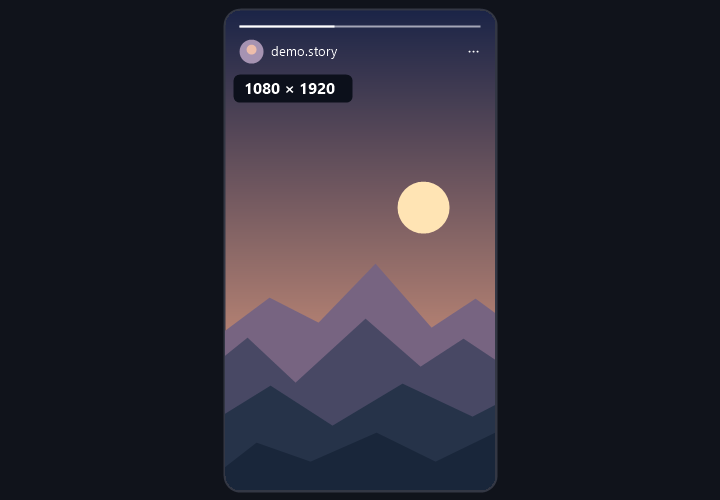

# Instagram Reels & Stories Resolution

## 한국어

인스타그램 웹에서 릴스와 스토리의 해상도를 `1080 × 1920`처럼 작게 표시하는 Tampermonkey 스크립트입니다. 동영상 해상도가 바뀌거나 다음 스토리로 넘어가면 자동으로 갱신됩니다. 스토리에서는 배지가 상단 버튼 아래에 맞춰집니다.

1. [Tampermonkey](https://www.tampermonkey.net/)를 설치합니다.
2. [스크립트 파일](instagram-reels-resolution.user.js)을 열고 **Raw**를 눌러 전체 코드를 복사합니다.
3. Tampermonkey에서 **새 스크립트 만들기**를 열고 기본 코드를 지운 뒤 붙여넣습니다. 기존 버전이 있다면 그 스크립트의 코드를 교체합니다.
4. `Ctrl + S`로 저장하고 인스타그램 탭을 새로고침합니다.

## English

A Tampermonkey script that displays the resolution of Instagram Reels and Stories on the web in a small badge such as `1080 × 1920`. It updates when the video resolution changes or you move to the next story. On Stories, the badge sits below the top controls.

1. Install [Tampermonkey](https://www.tampermonkey.net/).
2. Open the [userscript](instagram-reels-resolution.user.js), click **Raw**, and copy the full code.
3. Choose **Create a new script** in Tampermonkey and replace the default code with what you copied. If you already have the script, replace its existing code.
4. Press `Ctrl + S` to save, then refresh the Instagram tab.
